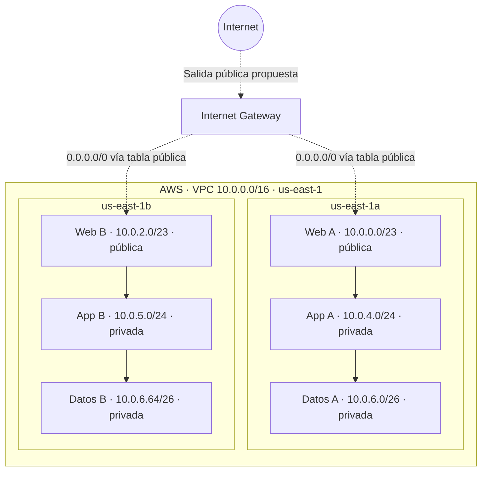
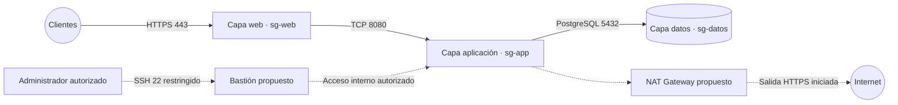
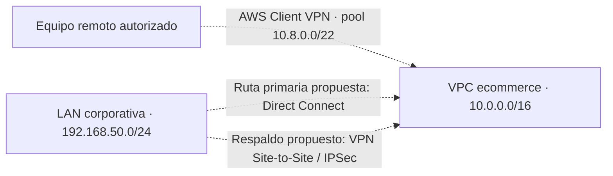

# AWS Enterprise Network Design

**Diseño de arquitectura de red empresarial en Amazon Web Services (AWS)**  
Diplomado en Cloud Infrastructure & DevSecOps · Módulo 1: Arquitectura de Nube y Redes Empresariales · UAGRM · Octubre de 2026

> [!IMPORTANT]
> **Modalidad: Ruta B — investigación y diseño técnico.** Este proyecto es un caso académico de una plataforma de comercio electrónico. **No se desplegaron recursos en AWS ni se ejecutaron pruebas reales de conectividad.** Los comandos, verificaciones y resultados descritos son procedimientos o resultados esperados; las capturas de documentación oficial no son evidencias de una implementación propia.

## Objetivo

Diseñar una red segmentada y segura para comercio electrónico sobre una VPC de AWS, abarcando **direccionamiento VLSM, ruteo, seguridad perimetral y conectividad híbrida**. Los tres laboratorios son etapas de una **misma arquitectura**, no tres infraestructuras independientes.

## Arquitectura base — Laboratorio 2

El diseño contempla **seis subredes en dos zonas de disponibilidad**, con tablas de ruteo diferenciadas para la capa web y las capas privadas. Las flechas entre capas son una **representación lógica** del sistema, no un registro de tráfico real.

[Detalle del Laboratorio 2](docs/lab-02-resumen.md) · [Plan de direccionamiento](addressing/README.md)

## Seguridad perimetral — Laboratorio 3

Se documentan **Security Groups, NACL, mínimo privilegio, bastión y NAT Gateway**. Estos componentes son parte de la propuesta de arquitectura; no son servicios creados en una cuenta AWS.

[Detalle del Laboratorio 3](docs/lab-03-resumen.md)

## Conectividad remota e híbrida — Laboratorio 4

Se investigan **AWS Client VPN**, VPN Site-to-Site, WireGuard y **Direct Connect**, incluida una estrategia conceptual de preferencia de rutas y conmutación mediante BGP. El rango de clientes `10.8.0.0/22` **no es una séptima subred de la VPC**.

[Detalle del Laboratorio 4](docs/lab-04-resumen.md)

## Direccionamiento VLSM

| Capa | Zona A | Zona B | Exposición prevista |
| --- | --- | --- | --- |
| Web | `10.0.0.0/23` | `10.0.2.0/23` | Pública |
| Aplicación | `10.0.4.0/24` | `10.0.5.0/24` | Privada |
| Datos | `10.0.6.0/26` | `10.0.6.64/26` | Privada |

## Documentación y figuras

- [Resumen del Laboratorio 2 — VPC, subredes y ruteo](docs/lab-02-resumen.md)
- [Resumen del Laboratorio 3 — seguridad y gateways](docs/lab-03-resumen.md)
- [Resumen del Laboratorio 4 — conectividad híbrida](docs/lab-04-resumen.md)
- [Plan de direccionamiento y decisiones](addressing/README.md)
- [Guía de las figuras originales y los tres informes PDF](docs/README.md)

Los **informes originales en PDF y seis figuras extraídas** se han preparado por separado para incorporarlos al repositorio. Hasta subir esos archivos binarios, el README utiliza diagramas Mermaid directamente visibles en GitHub.

## Tecnologías y conceptos

`AWS` · `Amazon VPC` · `IPv4 / VLSM` · `Route Tables` · `Internet Gateway` · `Security Groups` · `NACL` · `NAT Gateway` · `Bastion Host` · `Client VPN` · `Site-to-Site VPN` · `Direct Connect` · `BGP`

**Autor:** Elmer Fuentes Lozano · **Proyecto académico:** Universidad Autónoma Gabriel René Moreno (UAGRM)
