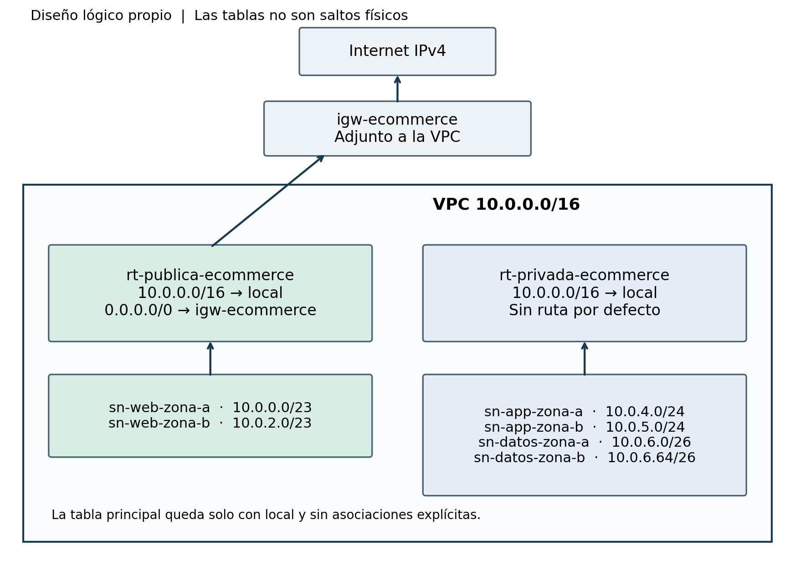
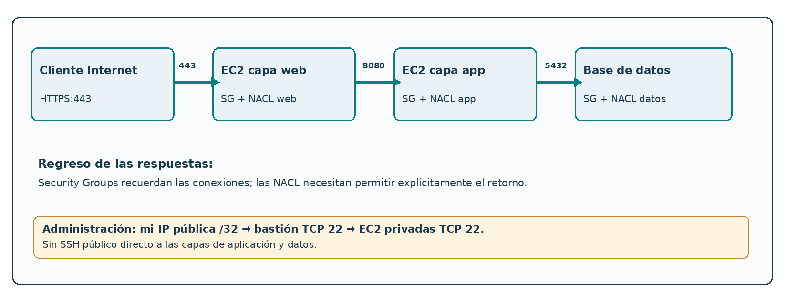
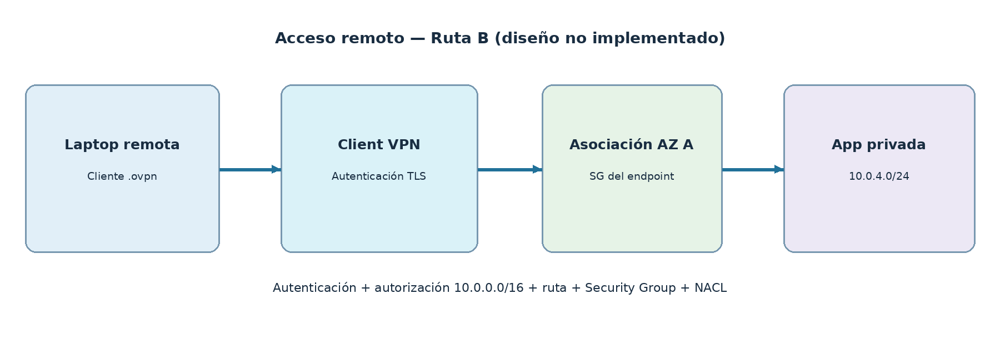

# Diagramas originales de arquitectura

Figuras de arquitectura extraídas de los informes técnicos de los Laboratorios 2, 3 y 4. Ilustran la evolución del diseño: segmentación de red, seguridad perimetral y acceso remoto.

## Laboratorio 2 — VPC y ruteo

[Ver imagen en tamaño completo](lab-02-vpc-subnets.png)

[Ver imagen en tamaño completo](lab-02-route-tables.png)

## Laboratorio 3 — Seguridad

[Ver imagen en tamaño completo](lab-03-security-architecture.png)

[Ver imagen en tamaño completo](lab-03-authorized-flows.png)

## Laboratorio 4 — Conectividad híbrida

[Ver imagen en tamaño completo](lab-04-client-vpn.png)

[Ver imagen en tamaño completo](lab-04-remote-access-flow.png)

[← Volver al README principal](../README.md) · [Abrir informes PDF](../docs/README.md)
