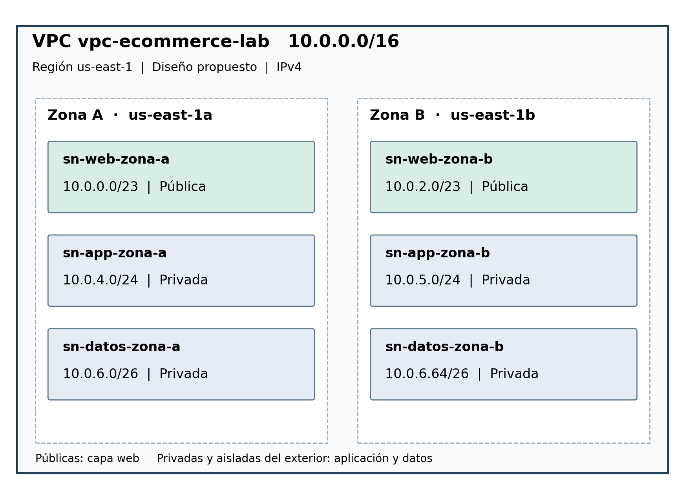

# Laboratorio 2 — Tablas de ruteo y conectividad entre subredes

**Ruta B: investigación y diseño técnico** · [**Abrir informe completo (PDF, 37 páginas)**](lab-02-vpc-routing.pdf)

Se diseñó una **VPC `10.0.0.0/16`** para un escenario de comercio electrónico, con **seis subredes** distribuidas entre capas web, aplicación y datos, en `us-east-1a` y `us-east-1b`.

## Decisiones documentadas

- Dimensionamiento **VLSM** para necesidades de 500, 250 y 50 hosts por capa y zona, considerando las cinco direcciones IPv4 reservadas por subred en AWS.
- Separación de subredes **públicas web** y **privadas de aplicación y datos**.
- Tablas de ruteo por función e **Internet Gateway** como salida directa a Internet para las subredes web.
- Procedimientos de diagnóstico conceptual para asociaciones de Route Tables, rutas `local` y `0.0.0.0/0`.

## Diagramas

[Ver topología completa](../diagrams/lab-02-vpc-subnets.png) · [Ver diseño de tablas de rutas](../diagrams/lab-02-route-tables.png)

## Alcance

Los pasos de consola, comandos AWS CLI y verificaciones son **procedimientos documentados**. **No se crearon recursos AWS ni se realizaron pruebas de conectividad**. Las capturas de páginas de documentación oficial AWS incluidas en el PDF son referencias, no pruebas de un despliegue propio.

[← Inicio](../README.md) · [Plan de direccionamiento](../addressing/README.md)
