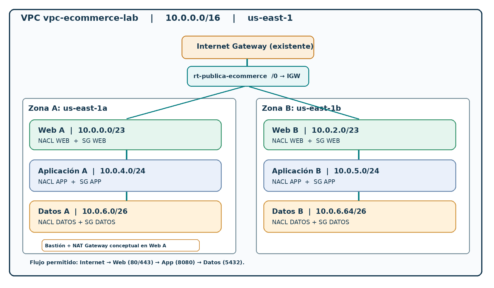

# Laboratorio 3 — Seguridad perimetral: Security Groups, NACLs y gateways

**Ruta B: investigación y diseño técnico** · [**Abrir informe completo (PDF, 32 páginas)**](lab-03-network-security.pdf)

Ampliación del escenario de comercio electrónico del Laboratorio 2, utilizando la misma **VPC `10.0.0.0/16`** y las seis subredes, con enfoque en **mínimo privilegio**.

## Controles estudiados

- **Security Groups** con estado y **Network ACLs** sin estado.
- Matriz propuesta: Internet → web por TCP 443 (80 opcional); web → aplicación por TCP 8080; aplicación → PostgreSQL por TCP 5432.
- **Bastión** para restringir el acceso administrativo a los servidores internos.
- Estudio de **NAT Gateway** para conexiones de salida iniciadas desde instancias privadas.
- Consideraciones de ruteo diferenciado por capa y continuidad entre zonas de disponibilidad.

## Diagramas

[Ver arquitectura completa](../diagrams/lab-03-security-architecture.png) · [Ver flujos autorizados](../diagrams/lab-03-authorized-flows.png)

## Alcance

Se documentaron reglas, recursos y pruebas **propuestas**; no se creó ni modificó infraestructura AWS ni se comprobaron conexiones reales.

[← Inicio](../README.md) · [Laboratorio anterior](lab-02-resumen.md)
