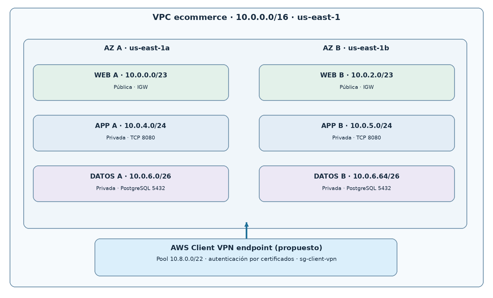

# Laboratorio 4 — Conectividad híbrida: VPN de acceso remoto y enlaces dedicados

**Ruta B: investigación y diseño técnico** · [**Abrir informe completo (PDF, 28 páginas)**](lab-04-hybrid-connectivity.pdf)

Estudio sobre acceso remoto seguro a los servicios privados de la arquitectura de comercio electrónico desarrollada en los laboratorios anteriores.

## Componentes y decisiones

- Propuesta de **AWS Client VPN** administrado, con rango de clientes `10.8.0.0/22`, sin solapamiento con la VPC `10.0.0.0/16`.
- Diseño documental de autenticación, asociaciones, autorización y rutas hacia redes privadas.
- Análisis de diferencias entre **WireGuard**, **VPN Site-to-Site/IPSec** y **AWS Direct Connect**.
- Diseño conceptual de una sede con LAN `192.168.50.0/24`, **Direct Connect primario** y **Site-to-Site VPN de respaldo**, contemplando preferencia BGP y validación de conmutación.

## Diagramas

[Ver extensión con Client VPN](../diagrams/lab-04-client-vpn.png) · [Ver flujo de acceso remoto](../diagrams/lab-04-remote-access-flow.png)

## Alcance

**No se crearon endpoints Client VPN, túneles, certificados ni enlaces Direct Connect**, ni se hicieron pruebas sobre instancias AWS del proyecto. Las verificaciones descritas son escenarios propuestos o resultados esperados.

[← Inicio](../README.md) · [Laboratorio anterior](lab-03-resumen.md)
